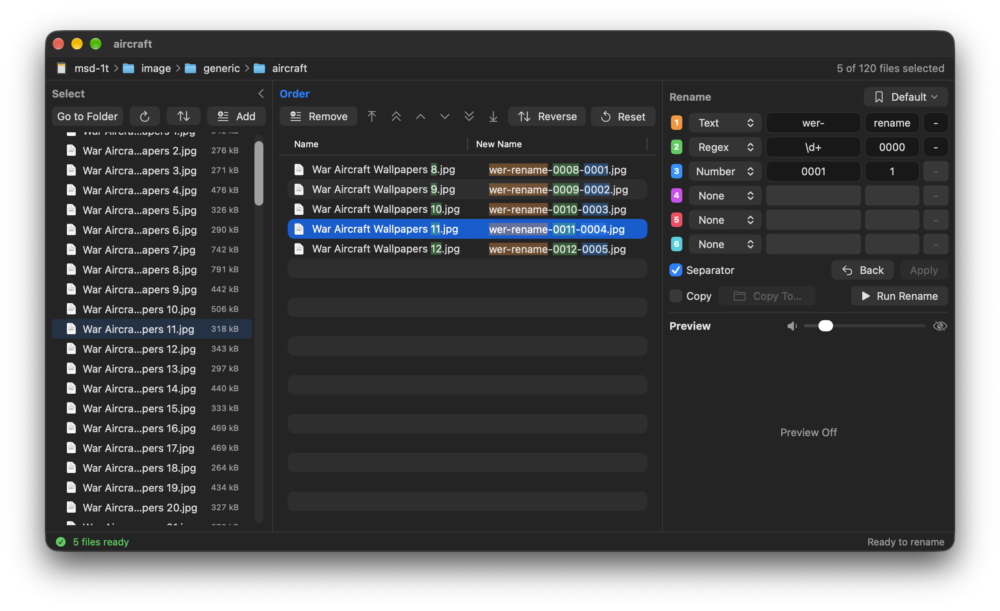
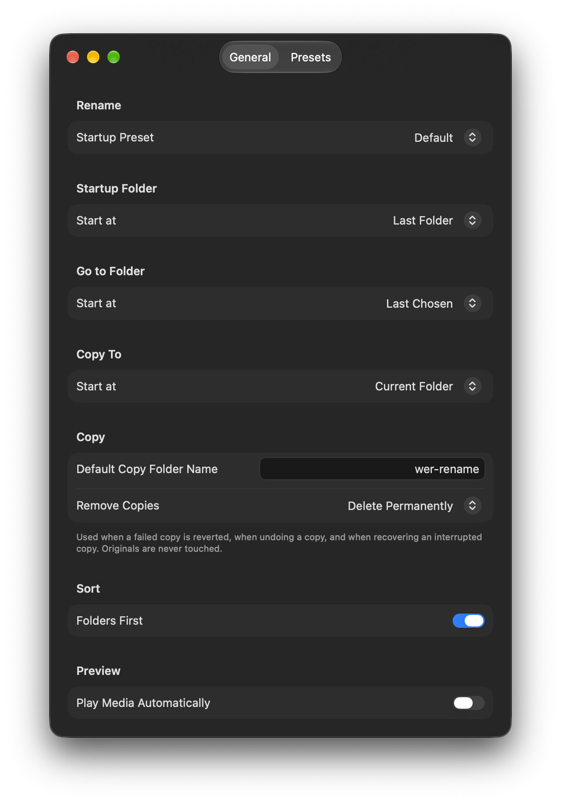
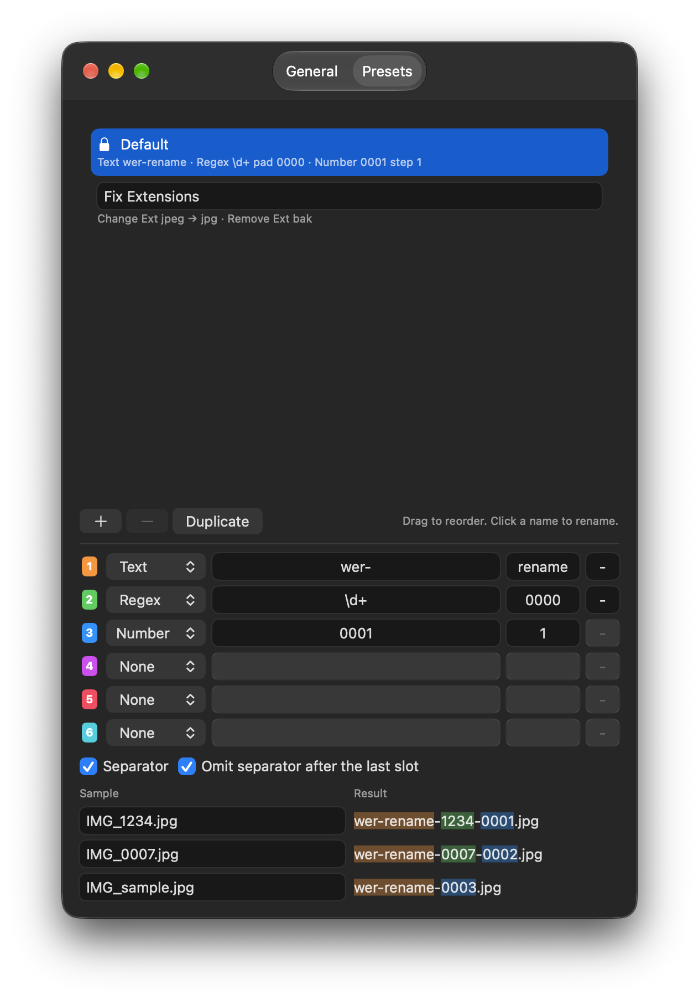

# WER

[English](README.md) | **한국어**

**Want to Edit file Rename** — 여러 파일의 이름을 내가 정한 규칙으로 한 번에 바꾸는 macOS 앱입니다.

파일을 고르고, 원하는 순서로 맞추고, 최대 여섯 칸으로 새 이름을 만들어 미리 본 뒤, 이름을 바꾸거나 복사합니다.



> [!WARNING]
> WER은 디스크의 실제 파일 이름을 바꿉니다. 중요한 파일은 백업하고, 먼저 테스트용 폴더에서 써 보세요.

## WER을 만든 이유

예전에는 여러 파일의 이름을 이렇게 바꿨습니다. `ls > file_list.txt`로 목록을 뽑아 텍스트 편집기에서 열고, 줄마다 `mv` 명령으로 고치고, 원하는 순서로 줄을 맞춘 뒤 터미널에서 실행했습니다. 되기는 했지만 느렸고, 오타 하나로 엉망이 될 수도 있었습니다.

일괄 이름 바꾸기 앱도 별 도움이 되지 않았습니다. 이름·날짜·크기 같은 정렬 기준으로 번호를 매기는데, 제가 원하는 순서는 대개 그중 어느 것도 아니었기 때문입니다. 눈으로 고른 사진, 스캔한 페이지, 편집용 영상 클립 같은 것들이죠. 그래서 빠져 있던 한 가지, 직접 정하는 순서를 중심으로 WER을 만들고, 실행 전에 모든 것을 확인하는 안전함은 그대로 가져왔습니다.

- **순서는 내가 정합니다.** WER은 두 목록을 나란히 둡니다. **Select**는 폴더 내용을, **Order**는 이름을 바꿀 파일만 내가 정한 순서 그대로 보여줍니다. 일부만 넣고, 사이에 끼워 넣고, 키보드나 끌기로 묶음째 옮기고, 구간을 뒤집으면 번호가 그 순서를 따릅니다.
- **실행 전에 결과를 봅니다.** 새 이름이 원래 이름 옆에 나오고, 어느 조각이 어느 부분을 만들었는지 색으로 보여주며, 이름 충돌과 실수는 실행 전에 표시합니다.
- **안심하고 써 볼 수 있습니다.** 실행은 전부 성공하거나 전부 되돌려지고, 마지막 실행은 되돌릴 수 있으며, 도중에 중단된 실행은 다음 실행 때 복구합니다.
- **키보드만으로 됩니다.** 고르기, 순서 맞추기, 규칙 만들기, 적용까지 키보드에서 손을 떼지 않고 할 수 있습니다([단축키](#단축키) 참고).

## 기능

- **Select**: 폴더의 파일을 고릅니다(하위 폴더는 보이지만 이름을 바꾸지 않음). Finder식 경로 표시줄, 경로 자동 완성이 되는 Go to Folder, 숫자 순서(file2, file10)와 글자 순서(file10, file2) 정렬.
- **Order**: 이름을 바꿀 파일의 순서를 맞춥니다. 위·아래로, 10칸씩, 맨 위·맨 아래로 옮기기, 끌어서 옮기기, 뒤집기, 폴더 순서로 되돌리기.
- **Rename**: 최대 여섯 칸으로 새 이름을 만듭니다. 칸마다 다음 중 하나를 고릅니다.
  - **Text** — 고정된 글자. 두 칸을 이어 붙임(예: `wer-` + `rename`)
  - **Regex** — 원래 이름의 일부. 왼쪽 채우기 가능(예: `\((\d+)\)` + `0000` → `0012`)
  - **Number** — 시작값, 자릿수, 증가 폭이 있는 연번(예: `0001`, 증가 폭 `1`)
  - **Change Ext** — 확장자를 다른 확장자로 바꿈. 대소문자까지 완전 일치(예: `jpeg` → `jpg`)
  - **Remove Ext** — 확장자를 지움. 대소문자까지 완전 일치(예: `bak`으로 `report.docx.bak`를 `report.docx`로 되돌림)
  - 확장자 규칙은 파일마다 원래 확장자에 한 번만 적용합니다. 한 규칙이 바꾼 결과를 다른 규칙이 다시 바꾸지 않습니다.
- 조각마다 구분자를 정할 수 있고, 새 이름의 어느 부분을 어느 조각이 만들었는지 색으로 강조합니다. 확장자 규칙은 Order에서 그 확장자를 가진 파일 수를 보여 줍니다(없으면 주황색).
- 꼭 채워야 하는데 빈 칸은 주황 테두리, 잘못 입력한 칸은 빨간 테두리로 표시합니다.
- **실행 전 검사**: 이름 중복, 폴더에 이미 있는 이름, 쓸 수 없는 문자(`/`, `:`), 255바이트를 넘는 이름, 숨김 파일이 되는 이름, 정규식 불일치. 대소문자를 구분하는 볼륨과 구분하지 않는 볼륨을 모두 처리합니다.
- **프리셋**: 이름 규칙을 저장하고 불러옵니다. 불러온 뒤 채울 빈 칸을 남긴 채 저장할 수 있습니다(⚠ 표시). 기본 제공 예시로 **Default**(Text, Regex, Number)와 **Fix Extensions**(Change Ext, Remove Ext)가 있습니다.
- **복사 모드**: 원본 이름을 바꾸지 않고, 새 이름으로 다른 폴더에 복사합니다.

## 안전장치

- 실행할 때마다 **확인 창**을 띄웁니다.
- **전부 아니면 전무**: 파일 하나라도 실패하면 그 실행의 변경을 모두 되돌립니다.
- 마지막 실행을 **되돌릴 수 있습니다**(Edit > Undo Last Rename, ⌥⌘Z).
- **복구**: 실행 도중 앱이 종료되면 다음 실행 때 원래 이름으로 되돌릴지 묻습니다.
- 복사 모드에서는 원본을 건드리지 않습니다. 복사본을 지울 때(실패, 되돌리기, 복구)는 기본적으로 영구 삭제하며, 설정에서 휴지통으로 옮기도록 바꿀 수 있습니다. 네트워크 드라이브와 일부 외장 볼륨에는 휴지통이 없어 항상 영구 삭제합니다.

## 사용법

1. **폴더 열기** — File > Open Folder…(⇧⌘O), Go to Folder…(⇧⌘G), 또는 터미널에서 `open -a WER <폴더>`.
2. **Select에서 파일을 골라 Order에 추가** — ⌘→, 더블클릭, 또는 끌어다 놓기. ⌥⌘→는 폴더의 파일을 모두 추가합니다.
3. **Order 순서 맞추기** — ⌘↑ / ⌘↓로 선택한 파일 이동, ⌥⌘↑ / ⌥⌘↓로 맨 위·맨 아래, 끌어서 이동, ⇧⌘R로 뒤집기. 새 이름의 번호는 이 순서대로 매겨집니다.
4. **Rename에서 규칙 만들기** — 칸마다 종류를 고르고(⌘1~⌘6으로 종류 메뉴 열기) 빈 칸으로 시작하는 입력칸을 채우거나, 프리셋을 불러옵니다(⌘L). **Separator**를 켜면 정해 둔 구분자로 조각을 잇습니다.
5. **Apply**(⌘↩) — New Name 열에 결과가 나옵니다. 빨간 이름과 아이콘은 이름 충돌이나 쓸 수 없는 이름이니 실행 전에 고칩니다. ⌘[는 이전 규칙으로 돌아갑니다.
6. **Run Rename** — 확인 창(확장자가 바뀌는 파일이 있으면 함께 알림)에서 실행하면 Preview 자리에 로그가 나옵니다. 원본 대신 다른 폴더에 새 이름으로 복사하려면 먼저 **Copy**를 켭니다. 마지막 실행은 ⌥⌘Z나 Undo 버튼으로 되돌립니다.

예: 사진을 `trip-0001.jpg`, `trip-0002.jpg`, …로 바꾸기 — 1번 칸 **Text** `trip`, 2번 칸 **Number** `0001`(증가 폭 `1`), Separator를 켜고 `-`. 확장자는 그대로 유지됩니다.

예: 확장자만 고치기 — **Fix Extensions**를 불러옵니다. `IMG_1234.jpeg`는 `IMG_1234.jpg`, `IMG_0007.jpeg.bak`은 `IMG_0007.jpeg`가 되고, 나머지 파일은 이름이 그대로입니다.

설정(⌘,)에서는 시작 프리셋과 시작 폴더를 정하고, 최대 세 개의 예시 파일 이름으로 결과를 보며 프리셋을 편집합니다.

<p align="center">
  
  
</p>

### 터미널에서 열기

`open -a WER <폴더 또는 파일>`을 실행하면 새 창에서 엽니다(파일이면 그 파일이 있는 폴더를 열고 파일을 선택). `open -a WER`만 입력하면 앱만 실행되므로, 현재 폴더를 열려면 `.`을 붙입니다.

```sh
open -a WER .
```

`wer`만 입력해서 열려면 `~/.zshrc`에 다음을 추가합니다.

```sh
wer() { open -a WER "${1:-.}"; }
```

`open -a`는 macOS가 등록해 둔 앱을 찾아 실행하므로, WER을 `/Applications`에 복사해 두면 안정적입니다.

## 단축키

화살표 단축키는 해당 목록에 포커스가 있을 때만 동작하므로, 입력칸에서는 ⌘ + 화살표가 원래대로 커서를 옮깁니다. ←와 →는 파일이 움직이는 방향입니다. ⌘는 포커스가 있는 목록의 선택을, ⌥⌘는 전부를 옮깁니다. 칸 제목을 클릭하면 그 칸으로 포커스가 옮겨지고, 포커스가 있는 칸의 제목은 강조색으로 표시됩니다.

| 메뉴 | 명령 | 단축키 |
|---|---|---|
| File | 선택한 항목 열기 | ⌘O |
| | Open Folder… | ⇧⌘O |
| | Go to Folder… | ⇧⌘G |
| | 상위 폴더로 (Select 포커스, Order가 비어 있을 때) | ⌘↑ |
| Edit | Undo Last Rename | ⌥⌘Z |
| View | Refresh | ⌘R |
| | Sort By > Switch Sort Order (숫자 ↔ 글자 순서) | ⌃⌘S |
| | Show Hidden Files | ⇧⌘. |
| | 미리보기 재생/일시정지 (동영상·오디오) | ⌘Y |
| | 다음 / 이전 칸 (Select → Order → Rename) | ⌘T / ⇧⌘T |
| Order | Order에 추가 (Select 포커스) | ⌘→ |
| | 전체를 Order에 추가 (Select 또는 Order 포커스) | ⌥⌘→ |
| | Order에서 빼기 (Order 포커스) | ⌘← |
| | Order 전부 비우기 (Select 또는 Order 포커스) | ⌥⌘← |
| | 위로 / 아래로 (Order 포커스) | ⌘↑ / ⌘↓ |
| | 맨 위로 / 맨 아래로 (Order 포커스) | ⌥⌘↑ / ⌥⌘↓ |
| | 뒤집기 (한 번 더 누르면 원래대로) | ⇧⌘R |
| Rename | 1~6번 칸의 종류 메뉴 열기 | ⌘1 – ⌘6 |
| | Apply | ⌘↩ |
| | Back | ⌘[ |
| | 프리셋 메뉴 열기 | ⌘L |

목록 안에서:

| 위치 | 동작 | 키 |
|---|---|---|
| Select | 선택한 항목 이름 바꾸기 (Finder처럼) | ↩, 확정은 ↩, 취소는 Esc |
| Select | 파일은 Order에 추가 / 폴더는 열기 | 더블클릭 |
| Select | 선택한 폴더로 들어가기 / 상위 폴더로 나오기 (Order가 비어 있을 때만) | → / ← |
| Order | 선택한 파일을 Order에서 빼기 (파일은 지우지 않음) | ⌫ |
| Select, Order | 미리보기의 동영상·오디오 재생/일시정지 | Space |

## 요구 사항

- macOS 27 이상
- Xcode 27 이상 (빌드할 때)

## 빌드

1. 저장소를 받습니다.
2. `Config/Local.xcconfig.example`을 `Config/Local.xcconfig`로 복사하고 자신의 Team ID와 번들 ID 앞부분을 넣습니다. 이 파일은 git에서 제외되어 서명 설정이 커밋에 들어가지 않습니다. (이 파일 없이 **Signing & Capabilities**에서 Team을 골라도 되지만, 그 변경은 커밋하지 마세요.)
3. Xcode에서 `WER.xcodeproj`를 열고 실행합니다(⌘R).

> [!NOTE]
> 어느 폴더든 열어서 이름을 바꿀 수 있도록 샌드박스를 쓰지 않습니다.

### 저장된 상태 초기화 (Debug 빌드)

처음 상태로 시작하려면 **Product > Scheme > Edit Scheme… > Run > Arguments**에서 `-resetAll YES` 실행 인자를 켭니다. 실행할 때 설정, 프리셋, 창 상태, 작업 기록을 지웁니다. 먼저 실행 중인 WER을 모두 종료하고, 다 쓴 뒤에는 인자를 다시 꺼 두세요.

## 라이선스

[Apache License, Version 2.0](LICENSE)을 따릅니다.
