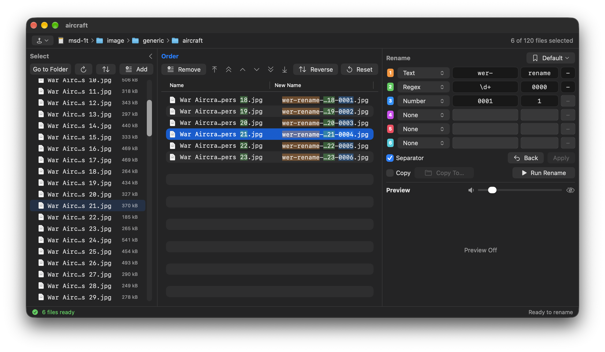
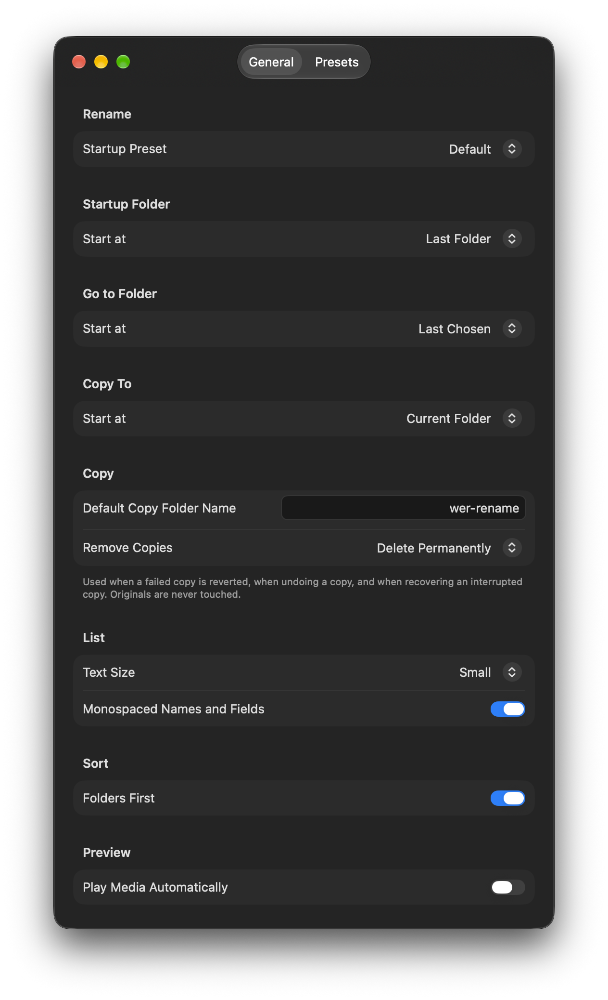
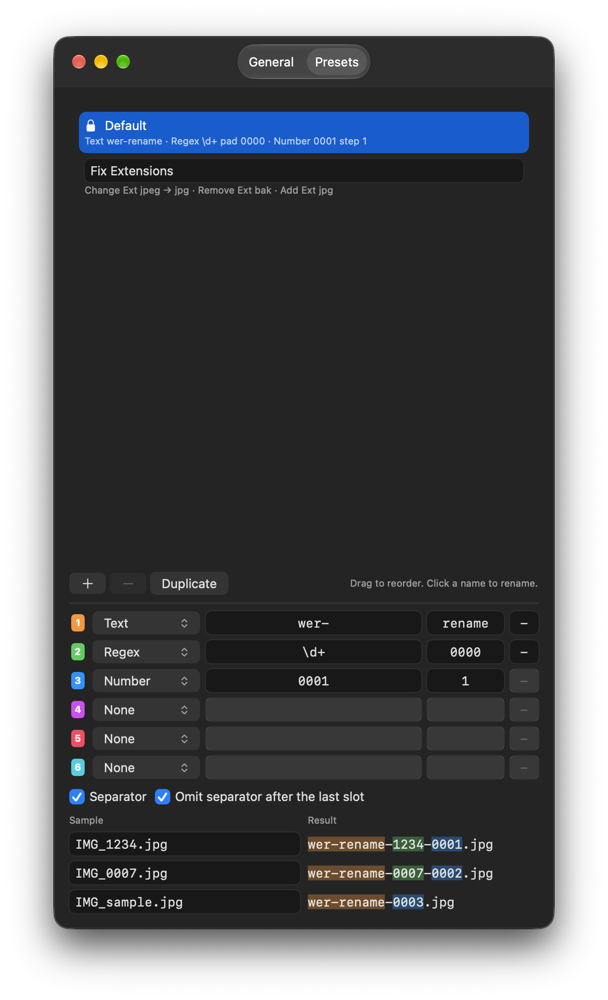

# WER

**English** | [한국어](README.ko.md)

**Want to Edit file Rename** — a macOS app for renaming many files at once with your own rules.

Pick files, put them in the order you want, build new names from up to six slots, preview the result, then rename or copy.



> [!WARNING]
> WER renames real files on your disk. Back up important files and try it on a test folder first.

## Why I Built WER

I used to rename batches of files like this: `ls > file_list.txt`, open the list in a text editor, turn each line into an `mv` command, put the lines in the order I wanted, and run it in Terminal. It worked, but it was slow and one typo could make a mess.

Batch renamers didn't help much, because they number files by a sort key — name, date, size — and the order I wanted usually wasn't any of those: photos picked by eye, scanned pages, clips for an edit. So I built WER around that one missing piece, an order you set yourself, and kept the safety of checking everything before it runs.

- **You decide the order.** WER keeps two lists side by side: **Select** shows the folder, **Order** holds only the files you're renaming, in exactly the order you set. Add some files, insert others in between, move blocks by keyboard or drag, reverse a block — numbers follow that order.
- **See it before it happens.** New names appear next to the old ones, colored by the part that made them, with conflicts and mistakes flagged before you run anything.
- **Safe to try.** Every run is all-or-nothing, the last run can be undone, and an interrupted run is restored on the next launch.
- **Keyboard first.** Pick, order, build the rule and apply without leaving the keyboard (see [Keyboard Shortcuts](#keyboard-shortcuts)).

## Features

- **Select** files in a folder (folders are shown but never renamed). Finder-like path bar with a Places menu (favorites, iCloud Drive and cloud storage such as Synology Drive, volumes, recent folders), Go to Folder with path completion, number order (file2, file10) or text order (file10, file2).
- **Order** the files that will be renamed: move up/down, by 10, to top/bottom, drag, reverse, reset to folder order.
- **Rename** with up to six slots, each one of:
  - **Text** — fixed text, in two fields joined together (e.g. `wer-` + `rename`)
  - **Regex** — part of the original name, with optional left padding (e.g. `\((\d+)\)` + `0000` → `0012`)
  - **Number** — sequence with start, digits and step (e.g. `0001`, step `1`)
  - **Change Ext** — change one extension to another, exact match (e.g. `jpeg` → `jpg`)
  - **Remove Ext** — remove an extension, exact match (e.g. `bak` to turn `report.docx.bak` back into `report.docx`)
  - **Add Ext** — add an extension to files that have none, such as downloads from a server (e.g. `jpg`: `IMG_sample` → `IMG_sample.jpg`)
  - Extension rules apply once per file, to its original extension; a result is never changed again by another rule.
- Per-part separators, colored highlights that show which part made which piece of the new name. Extension rules show how many files in Order they match (orange when none). Empty required fields are outlined in orange, invalid ones in red.
- **Checks before running**: duplicate names, names already in the folder, invalid characters (`/`, `:`), names longer than 255 bytes, hidden names, regex mismatches. Case-sensitive and case-insensitive volumes are handled.
- **Presets**: save and load naming rules. A preset can keep empty fields to fill in after loading (marked ⚠). Built-in examples: **Default** (Text, Regex, Number) and **Fix Extensions** (Change Ext, Remove Ext, Add Ext).
- **Copy mode**: write renamed copies to another folder instead of renaming originals. Drop a folder on Copy To to choose it.
- **Display**: list text size (Small, Medium, Large) and a fixed-width font for file names and name fields, so numbers line up (on by default).

## Safety

- **Confirmation** before every run.
- **All or nothing**: if any file fails, every change in that run is reverted.
- **Undo** the last run (Edit > Undo Last Rename, ⌥⌘Z).
- **Recovery**: if the app quits in the middle of a run, it offers to restore the original names on the next launch.
- Originals are never touched in copy mode. Removing copies (on failure, undo, or recovery) deletes them permanently by default; you can choose to move them to the Trash in Settings. Network drives and some external volumes have no Trash, so copies there are always deleted permanently.

## Usage

1. **Open a folder** — File > Open Folder… (⇧⌘O), Go to Folder… (⇧⌘G), the Places menu at the start of the path bar, `open -a WER <folder>` from Terminal, or drag a folder or file from Finder onto the window or the Dock icon. A dropped file opens its folder with the file selected; dropped onto Order, the files are also added to Order. If Order has files, you're asked before it's cleared. Cloud storage folders such as Synology Drive may ask you once to allow access in an Open dialog.
2. **Pick files in Select** and add them to **Order** — ⌘→, double-click, or drag. ⌥⌘→ adds every file in the folder.
3. **Arrange Order** — ⌘↑ / ⌘↓ moves the selection, ⌥⌘↑ / ⌥⌘↓ to top or bottom, drag to move, ⇧⌘R reverses. New names are numbered in this order.
4. **Build the rule in Rename** — choose a type for each slot (⌘1–⌘6 opens the type menu) and fill in its fields, which start empty, or load a preset (⌘L). Turn on **Separator** to join the parts with the separators you set.
5. **Apply** (⌘↩) — the New Name column shows the result. Red names and icons mark conflicts or invalid names; fix them before running. ⌘[ goes back to the previous rule.
6. **Run Rename** — confirm (the dialog also warns when extensions will change), and watch the log in the Preview area. Turn on **Copy** first to write renamed copies to another folder instead. Undo the last run with ⌥⌘Z or the Undo button.

Example — rename photos to `trip-0001.jpg`, `trip-0002.jpg`, …: slot 1 **Text** `trip`, slot 2 **Number** `0001` with step `1`, Separator on with `-`. The extension is kept.

Example — fix extensions only: load **Fix Extensions**. `IMG_1234.jpeg` becomes `IMG_1234.jpg`, `IMG_0007.jpeg.bak` becomes `IMG_0007.jpeg`, `IMG_sample` (no extension) becomes `IMG_sample.jpg`, and other files keep their names.

Settings (⌘,) holds the startup preset, start folders, list text size and fixed-width font, and presets you can edit while checking the result on up to three sample names:

<p align="center">
  
  
</p>

### Open from Terminal

`open -a WER <folder or file>` opens it in a new window (a file opens its folder with the file selected). `open -a WER` alone only launches the app, so pass `.` for the current folder:

```sh
open -a WER .
```

To type just `wer`, add this to `~/.zshrc`:

```sh
wer() { open -a WER "${1:-.}"; }
```

`open -a` finds the app through Launch Services, so copy WER to `/Applications` for reliable results.

## Keyboard Shortcuts

Arrow-key shortcuts work only while the list they belong to has focus, so ⌘ + arrow keys keep moving the cursor in text fields. ← and → point the way files move: ⌘ moves the selection of the focused list, ⌥⌘ moves everything. Click a pane title to focus that pane. The focused pane's title is shown in the accent color.

| Menu | Command | Shortcut |
|---|---|---|
| File | Open selected items | ⌘O |
| | Open Folder… | ⇧⌘O |
| | Go to Folder… | ⇧⌘G |
| | Enclosing Folder (Select focused, Order empty) | ⌘↑ |
| Edit | Undo Last Rename | ⌥⌘Z |
| View | Refresh | ⌘R |
| | Sort By > Switch Sort Order (Number ↔ Text order) | ⌃⌘S |
| | Show Hidden Files | ⇧⌘. |
| | Play/Pause Preview (video or audio) | ⌘Y |
| | Next / Previous Pane (Select → Order → Rename) | ⌘T / ⇧⌘T |
| Order | Add to Order (Select focused) | ⌘→ |
| | Add All to Order (Select or Order focused) | ⌥⌘→ |
| | Remove from Order (Order focused) | ⌘← |
| | Remove All from Order (Select or Order focused) | ⌥⌘← |
| | Move Up / Down (Order focused) | ⌘↑ / ⌘↓ |
| | Move to Top / Bottom (Order focused) | ⌥⌘↑ / ⌥⌘↓ |
| | Reverse (press again to undo) | ⇧⌘R |
| Rename | Open type menu of slot 1–6 | ⌘1 – ⌘6 |
| | Apply | ⌘↩ |
| | Back | ⌘[ |
| | Open the preset menu | ⌘L |

In the lists:

| Where | Action | Key |
|---|---|---|
| Select | Rename the selected item (like Finder) | ↩, then ↩ to confirm or Esc to cancel |
| Select | Add files to Order / open a folder | Double-click |
| Select | Go into the selected folder / up to the enclosing folder (only while Order is empty) | → / ← |
| Order | Remove selected files from Order (files are not deleted) | ⌫ |
| Select, Order | Play/pause the video or audio in Preview | Space |

## Requirements

- macOS 27 or later
- Xcode 27 or later (to build)

## Building

1. Clone the repository.
2. Copy `Config/Local.xcconfig.example` to `Config/Local.xcconfig` and set your Team ID and bundle ID prefix. This file is ignored by git, so your signing settings stay out of commits. (Without it, choose a Team in **Signing & Capabilities** — but don't commit that change.)
3. Open `WER.xcodeproj` in Xcode and run (⌘R).

> [!NOTE]
> The app is not sandboxed so that it can rename files in any folder you open.

### Resetting saved state (Debug builds)

To start from a clean state, enable the `-resetAll YES` launch argument in **Product > Scheme > Edit Scheme… > Run > Arguments**. It clears settings, presets, window state and the rename journal on launch. Quit any running copies of WER first, and turn the argument off again afterwards.

## License

Licensed under the [Apache License, Version 2.0](LICENSE).
